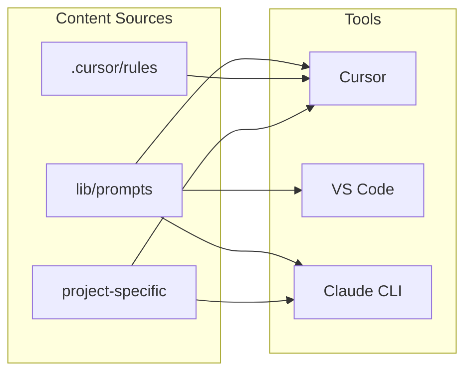

# Architecture

This document describes how the AI Toolkit’s prompts, rules, and tools fit together.

## Layers

| Layer                | Location            | Role                                                                                                                                                  |
| -------------------- | ------------------- | ----------------------------------------------------------------------------------------------------------------------------------------------------- |
| **Prompts**          | `lib/prompts/`      | Portable, copy-paste content. Platform-agnostic; use with any LLM (Cursor, VS Code, Claude CLI, ChatGPT, etc.).                                       |
| **Cursor rules**     | `.cursor/rules/`    | Persistent in-editor context for Cursor. File-scoped or always-on; summarize or reference toolkit standards.                                          |
| **Project-specific** | `project-specific/` | Optional overrides or extensions for a specific client or repo (e.g. Anadolu Sigorta). Copy into a project’s `.cursor/rules` or use as prompt prefix. |

## Flow

1. **Choose a tool**: Cursor (recommended for full rules), VS Code (with Copilot or similar), or Claude Code CLI.
2. **Apply base context**: In Cursor, rules in `.cursor/rules/` load automatically. In other tools, use prompts from `lib/prompts/` as system or context.
3. **Stack prompts** (when using copy-paste): core → feature → project-specific (if any) → task. See [Usage suggestions](usage-suggestions.md).
4. **Optional project override**: For a given client/repo, add or copy a file from `project-specific/` so that project’s conventions take precedence when combined with global prompts/rules.

## Single source of truth

- **Prompts** in `lib/prompts/` are the canonical wording for “what we tell the AI.” Cursor rules can mirror or summarize them so the editor has persistent context; the detailed, versioned text stays in prompts.
- The **`.cursor/rules/`** in this repo are hand-maintained summaries that point to the full prompts in `lib/prompts/`. The CLI installs from `lib/prompts/` only. When contributing, update prompts in `lib/prompts/` and optionally sync the summaries in `.cursor/rules/`.
- **Project-specific** files extend or override global behavior only for that project; they do not replace the global prompts.

## Shared rule bundles (optional)

- **`lib/shared/.cursor/`** holds an optional, extended set of Cursor rule bundles (e.g. Next.js, React Native, Redux, Styled Components). These are **not** installed by the CLI. Use them by copying the `.mdc` files or whole bundle folders into your project’s `.cursor/rules/` when you need that stack. They may overlap in theme with `lib/prompts/` but are not kept in sync with it by default; **`lib/prompts/`** remains the single source of truth for the standard toolkit.
